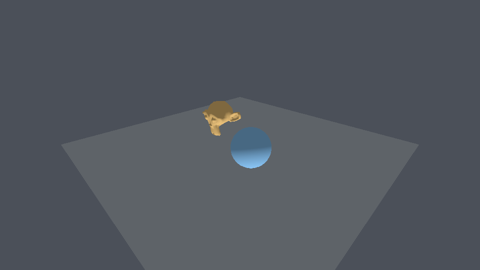

# ai-native-3d-engine

[](https://github.com/MarkWaldeis/ai-native-3d-engine/actions/workflows/ci.yml)

An AI-native 3D game engine prototype written in Rust. The engine runs as an
**MCP stdio or HTTP server**: AI agents (Claude Code, Devin, Poke, …) connect over
newline-delimited JSON-RPC and drive the engine through typed tools — spawn
geometry, move the camera, render headless screenshots, and run Blender
scripts — instead of a human clicking in a viewport.

v0.1 is a working vertical slice: full MCP round-trip → world state → wgpu
headless render → PNG screenshot back to the agent.



*`cargo run -- --demo docs/gltf_demo.png docs/demo_scene.json` — real wgpu headless
output: procedural floor, a Blender-exported `suzanne.glb` loaded through the
`gltf` spawn path, and a sphere.*

> 📐 Original design doc (German, by Gemini): [docs/masterplan.md](docs/masterplan.md) —
> the multi-agent architecture this workspace was built from.

## Workspace layout

```
Cargo.toml               root binary `ai-engine` (MCP stdio server + --demo)
src/
  main.rs                stdin/stdout JSON-RPC loop
  lib.rs                 `Engine` facade: World + Renderer + AssetPipeline + tool dispatch
shared/                  serializable contracts shared by all crates
  scene.rs               Scene / Entity / Transform / Camera / PrimitiveKind
  mcp_protocol.rs        JSON-RPC 2.0 types + the MCP tool surface (tools/list schemas)
  mesh.rs                CPU vertex/index buffers produced from primitives
  mocks.rs               deterministic mock scene for tests & --demo
crates/
  engine-core/           World state, command queue, save/load (flat Vec ECS, revision counter)
  engine-render/         wgpu headless renderer → PNG readback → base64
  engine-geo/            procedural mesh generation (box, plane, sphere, cylinder, wall_with_door)
  engine-mcp/            JSON-RPC framing + MCP lifecycle (initialize, ping, tools/list, tools/call)
  asset-pipeline/        finds Blender, runs `blender --background --factory-startup --python`,
                         watches assets/ for changed files
  engine-tests/          end-to-end tests driving the engine like an MCP client
```

## MCP tool surface

| Tool | Purpose |
|---|---|
| `get_scene_state` | entire scene as JSON (entities, transforms, camera) |
| `spawn_primitive` | box / plane / sphere / cylinder / wall_with_door **or `kind:"gltf"` + `path`** (GLB from `assets/`) with transform + RGBA |
| `set_transform` | position / rotation (deg) / scale by entity id |
| `set_color` | RGBA by entity id |
| `remove_entity` | delete by id |
| `set_camera` | position / target / fov |
| `get_screenshot` | headless render → base64 PNG (`content[].type = "image"`) |
| `save_scene` / `load_scene` | persist scene to/from `.json` |
| `get_revision` | current world revision (concurrency token) |
| `rollback` | restore scene to an earlier revision |
| `apply_batch` | apply N commands atomically in one call — the engine's "tick" |
| `list_assets` | list files in `assets/` |
| `run_blender_script` | headless Blender → generated GLB assets land in `assets/` |
| `blender_status` / `blender_start` | inspect local bridge/version or launch an engine-owned headless bridge |
| `blender_exec` / `blender_scene_info` | run trusted Python on Blender's main thread; inspect objects and `ai_*` props |
| `blender_sync` | export meshes to `assets/blender/`, upsert by stable `source_uid`; optional `objects` names/UIDs and explicit `prune:true` |
| `claim_entities` / `release_entities` / `list_locks` | agent-owned entity locks with expiry (`ttl_s`, default 60, range 1–86400) |
| `get_changes_since` | scene mutation journal after `revision`: agent, tool, affected entity `ids` |
| `task_create` / `task_claim` / `task_complete` / `task_list` | shared task board; dependencies must complete before claim |

Every mutating tool accepts an optional `expected_revision` integer.

## Quickstart

```bash
cargo build --workspace
cargo test --workspace                              # 17 tests incl. real GPU + GLB round-trips
cargo run -- --demo out.png                         # render the mock scene → PNG
cargo run -- --demo out.png docs/demo_scene.json    # render a saved scene → PNG
cargo run                                           # MCP stdio server (logs → stderr, protocol → stdout)
cargo run -- --serve 127.0.0.1:7777                  # shared-world HTTP server: POST /mcp
```

On macOS/Linux install a stable Rust toolchain with rustup; no linker overrides
are needed. The Windows-GNU linker setting is target-scoped and remains in
`.cargo/config.toml`. GPU tests print `SKIP` if no renderer is available.

HTTP accepts one JSON-RPC request per `POST /mcp` and returns one JSON response
(`null` for notifications). Multiple clients share one engine, with calls
serialized on a dedicated engine thread (including GPU work). Supply an optional
`agent` string in tool arguments or an `X-Agent-Id` HTTP header; the argument
wins, otherwise identity defaults to `anonymous`. Use distinct identities per
worker. This is coordination, not authentication: bind to localhost on trusted
machines; do not expose the server publicly.

```bash
curl http://127.0.0.1:7777/mcp -H 'X-Agent-Id: level-designer' \
  -d '{"jsonrpc":"2.0","id":1,"method":"tools/call","params":{"name":"spawn_primitive","arguments":{"kind":"box"}}}'
```

Locks reject edits/removal by other agents, including batch commands. Replacing
the world (`load_scene`/`rollback`) requires no foreign entity locks. Claims and
releases are all-or-nothing; expired locks disappear automatically on the next
call. A batch inherits its outer agent (subcommands cannot override it).
`get_changes_since` returns `{entries, current_revision, oldest_revision}`;
the last 1024 scene mutations are retained. Each successful batch subcommand is
journaled separately; lock/task metadata does not advance the scene revision.
If your revision predates the journal window, re-read the scene. All coordination
state is in memory and resets on restart.

Tasks start `pending`, become `claimed` with an owner, then `completed` by that
owner. `task_create` takes `title`, optional `description` and existing
`depends_on` task ids. `task_list` optionally filters `status` (`pending`,
`claimed`, `completed`); completion accepts an optional `note`.

Example session (one JSON object per line):

```json
{"jsonrpc":"2.0","id":1,"method":"initialize","params":{}}
{"jsonrpc":"2.0","id":2,"method":"tools/call","params":{"name":"spawn_primitive","arguments":{"kind":"box","name":"crate","position":[0,0.5,0],"color":[1,0.4,0.1,1]}}}
{"jsonrpc":"2.0","id":3,"method":"tools/call","params":{"name":"get_screenshot","arguments":{"width":960,"height":540}}}
```

## Design notes for the evaluator

### Blender-first bridge

Blender is found on PATH, in `/Applications/Blender.app`, or in the existing
Windows Blender Foundation directories. Start the bridge through `blender_start`
or manually:

```bash
blender --background --factory-startup --python blender/ai_engine_bridge.py
```

For **interactive Blender**, install `blender/ai_engine_bridge.py` as a legacy
add-on through Preferences → Add-ons → Install from Disk, then enable **AI Engine
Bridge**. Alternatively open the script in Blender's Text Editor and choose
**Run Script**. Rerunning replaces the previous listener; disabling the add-on
stops it. Interactive commands run through `bpy.app.timers` on Blender's main
thread; headless mode pumps the same queue on the main thread and stays alive.

The protocol is one newline-terminated JSON request/response per TCP connection
at `127.0.0.1:9876`. Set `AI_ENGINE_BLENDER_PORT` in **both** the engine and Blender
environments to choose another port. Commands are `ping`, `exec {code}`,
`scene_info`, and `export {dir, objects?, whole_scene?}`. `exec` returns captured
stdout and a JSON-serializable `result` variable; each call has a fresh Python
namespace (`bpy` scene state persists). This is **arbitrary local Python execution**,
not a sandbox or authentication boundary: trusted local clients only.

`blender_start` connects to an existing bridge without owning it, or starts a
headless process that is terminated when its owning Engine is dropped. Startup
uses the repository's bridge script; retain the `blender/` directory with the
engine. `blender_status` gives startup instructions if disconnected.

`blender_sync` assigns missing `ai_uid` custom properties and stores them as
`Entity.source_uid`, with all `ai_*` custom properties in `Entity.props`.
Save the `.blend` file to preserve these UIDs across Blender restarts. Re-sync
updates mesh, name, transform, base color and props while preserving engine ids.
Duplicated Blender objects with copied UIDs receive distinct UIDs on inspection/
export. Existing JSON scenes remain compatible through serde defaults.

The default export is one evaluated mesh per GLB, with world placement represented
once by the Entity transform. Blender `(x,y,z)` becomes engine `(x,z,-y)`;
orientation is converted with the same basis and residual parent shear is baked
into geometry. Parent transforms/modifiers are included. Whole-scene export
instead bakes world placement into one GLB and reports `baked_world_transform`.
The current renderer uses one base color per object; textures and multi-material
shading are not yet reproduced.

Each sync is one revision/journal entry and respects `agent`, `expected_revision`
and foreign entity locks. Without `prune:true`, vanished objects remain. With
pruning, only previously synced objects absent from the complete Blender mesh
list are removed; filtering `objects` never deletes other still-existing objects.
Export filenames are versioned so locked entities and rollback snapshots keep
their original geometry. Generated GLBs are ignored by git; retain them beside
saved scenes (old exports are not automatically garbage-collected).

`cargo test -p engine-tests --test blender_bridge -- --nocapture` runs the real
headless Blender E2E when installed, otherwise prints `SKIP`. A reproducible
scene is in `blender/sync_demo.py`; comparison images:
[`docs/blender_sync_demo.png`](docs/blender_sync_demo.png) (engine) and
[`docs/blender_sync_reference.png`](docs/blender_sync_reference.png) (Blender).

- **AI-native control loop**: the whole engine is behind typed MCP tools. An
  agent can `get_scene_state` → mutate → `get_screenshot` → iterate — the same
  critic/reviewer loop a human artist would run, fully automated.
- **Plain-JSON scene**: `shared::scene::Scene` is the single source of truth,
  serializable, diffable, and loadable — a world state agents can read and
  reason about directly.
- **Deterministic conflict resolution**: mutations are serialized by the
  single-threaded stdio loop (line order = canonical order). `apply_batch`
  makes "same tick" explicit — its commands run atomically in array order
  within one call. On top of that, `expected_revision` adds optimistic
  concurrency — when two agents read the same revision and both mutate,
  the first wins and the second gets a `revision conflict` error and must
  re-read. Every mutation records a per-revision `Scene` snapshot (ring of
  64), so `rollback` restores any recent state while the revision counter
  stays monotonic.
- **Deterministic + fast**: spawn→state round-trip < 100 ms (asserted in tests);
  world `revision` counter acts as a render dirty-flag.
- **Headless rendering**: wgpu renders off-screen with no window — works on a
  headless agent box; screenshot path is exercised by a real GPU test.
- **glTF/GLB loading**: `kind:"gltf"` spawns entities from `.glb` files —
  `engine-geo::load_gltf` fuses all node meshes with baked transforms.
  `assets/suzanne.glb` (exported headless from Blender 5.2) is committed as a
  fixture; `docs/demo_scene.json` shows the format.
- **Asset pipeline hook**: agents can ship a Blender Python script through MCP
  (`run_blender_script`) to turn generated art into GLB assets in `assets/`.
- **Graceful degradation**: MCP world-editing tools work with no GPU; only
  `get_screenshot` requires one (renderer is lazily initialized).

## Roadmap

- [x] deterministic conflict resolution (`expected_revision` CAS + rollback)
- [x] glTF/GLB mesh import (`spawn_primitive kind:"gltf"` → `assets/*.glb` → GPU)
- [ ] windowed mode + interactive camera (winit)
- [ ] richer primitive/CSG set (real boolean ops in `engine-geo`)
- [ ] multi-agent session support (named worlds / command queue per agent)
- [ ] textures + materials, HDR lighting
- [ ] physics + gameplay scripting layer
