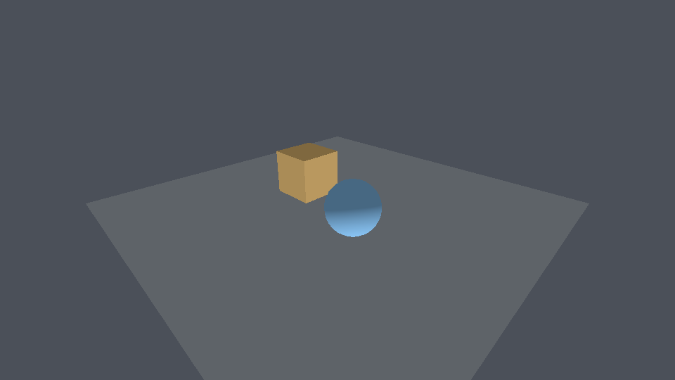

# ai-native-3d-engine

An AI-native 3D game engine prototype written in Rust. The engine runs as an
**MCP stdio server**: AI agents (Claude Code, Devin, Poke, …) connect over
newline-delimited JSON-RPC and drive the engine through typed tools — spawn
geometry, move the camera, render headless screenshots, and run Blender
scripts — instead of a human clicking in a viewport.

v0.1 is a working vertical slice: full MCP round-trip → world state → wgpu
headless render → PNG screenshot back to the agent.



*`cargo run -- --demo docs/demo.png` — real wgpu headless output.*

## Workspace layout

```
Cargo.toml               root binary `ai-engine` (MCP stdio server + --demo)
src/
  main.rs                stdin/stdout JSON-RPC loop
  lib.rs                 `Engine` facade: World + Renderer + AssetPipeline + tool dispatch
shared/                  serializable contracts shared by all crates
  scene.rs               Scene / Entity / Transform / Camera / PrimitiveKind
  mcp_protocol.rs        JSON-RPC 2.0 types + the MCP tool surface (tools/list schemas)
  mesh.rs                CPU vertex/index buffers produced from primitives
  mocks.rs               deterministic mock scene for tests & --demo
crates/
  engine-core/           World state, command queue, save/load (flat Vec ECS, revision counter)
  engine-render/         wgpu headless renderer → PNG readback → base64
  engine-geo/            procedural mesh generation (box, plane, sphere, cylinder, wall_with_door)
  engine-mcp/            JSON-RPC framing + MCP lifecycle (initialize, ping, tools/list, tools/call)
  asset-pipeline/        finds Blender, runs `blender --background --factory-startup --python`,
                         watches assets/ for changed files
  engine-tests/          end-to-end tests driving the engine like an MCP client
```

## MCP tool surface

| Tool | Purpose |
|---|---|
| `get_scene_state` | entire scene as JSON (entities, transforms, camera) |
| `spawn_primitive` | box / plane / sphere / cylinder / wall_with_door with transform + RGBA |
| `set_transform` | position / rotation (deg) / scale by entity id |
| `set_color` | RGBA by entity id |
| `remove_entity` | delete by id |
| `set_camera` | position / target / fov |
| `get_screenshot` | headless render → base64 PNG (`content[].type = "image"`) |
| `save_scene` / `load_scene` | persist scene to/from `.json` |
| `list_assets` | list files in `assets/` |
| `run_blender_script` | headless Blender → generated GLB assets land in `assets/` |

## Quickstart

```bash
cargo build --workspace
cargo test --workspace          # 12 tests incl. real GPU screenshot round-trip
cargo run -- --demo out.png     # render the mock scene once, write PNG
cargo run                       # MCP stdio server (logs → stderr, protocol → stdout)
```

Example session (one JSON object per line):

```json
{"jsonrpc":"2.0","id":1,"method":"initialize","params":{}}
{"jsonrpc":"2.0","id":2,"method":"tools/call","params":{"name":"spawn_primitive","arguments":{"kind":"box","name":"crate","position":[0,0.5,0],"color":[1,0.4,0.1,1]}}}
{"jsonrpc":"2.0","id":3,"method":"tools/call","params":{"name":"get_screenshot","arguments":{"width":960,"height":540}}}
```

## Design notes for the evaluator

- **AI-native control loop**: the whole engine is behind typed MCP tools. An
  agent can `get_scene_state` → mutate → `get_screenshot` → iterate — the same
  critic/reviewer loop a human artist would run, fully automated.
- **Plain-JSON scene**: `shared::scene::Scene` is the single source of truth,
  serializable, diffable, and loadable — a world state agents can read and
  reason about directly.
- **Deterministic + fast**: spawn→state round-trip < 100 ms (asserted in tests);
  world `revision` counter acts as a render dirty-flag.
- **Headless rendering**: wgpu renders off-screen with no window — works on a
  headless agent box; screenshot path is exercised by a real GPU test.
- **Asset pipeline hook**: agents can ship a Blender Python script through MCP
  (`run_blender_script`) to turn generated art into GLB assets in `assets/`.
- **Graceful degradation**: MCP world-editing tools work with no GPU; only
  `get_screenshot` requires one (renderer is lazily initialized).

## Roadmap

- [ ] glTF/GLB mesh import (`load_asset` tool → `assets/*.glb` → GPU)
- [ ] windowed mode + interactive camera (winit)
- [ ] richer primitive/CSG set (real boolean ops in `engine-geo`)
- [ ] multi-agent session support (named worlds / command queue per agent)
- [ ] textures + materials, HDR lighting
- [ ] physics + gameplay scripting layer
