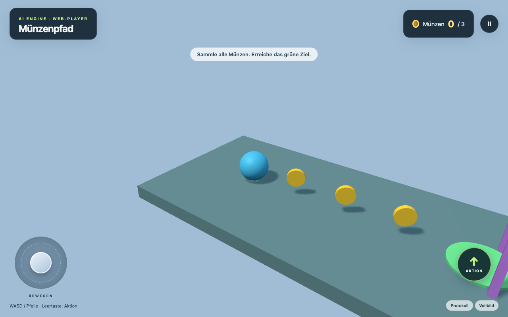
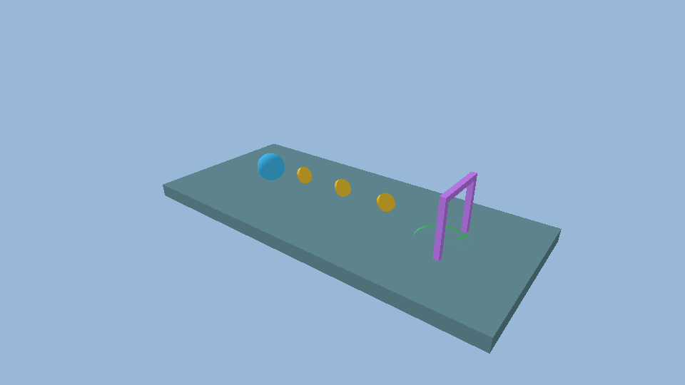
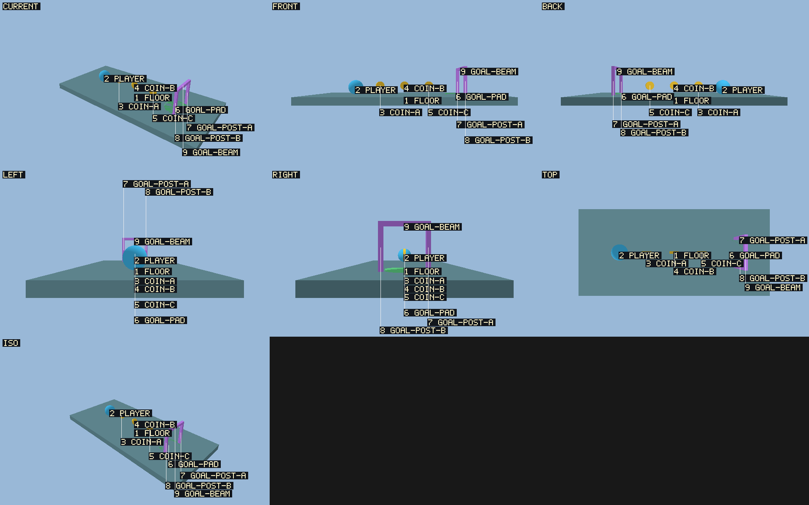

# ai-native-3d-engine

[](https://github.com/MarkWaldeis/ai-native-3d-engine/actions/workflows/ci.yml)

An AI-native 3D game engine prototype written in Rust. The engine runs as an
**MCP stdio or HTTP server**: AI agents (Claude Code, Devin, Poke, …) connect over
newline-delimited JSON-RPC and drive the engine through typed tools — spawn
geometry, move the camera, render headless screenshots, and run Blender
scripts — instead of a human clicking in a viewport.

v0.1 is a working vertical slice: full MCP round-trip → world state → wgpu
headless render → PNG screenshot back to the agent.


*`cargo run -- --demo docs/gltf_demo.png docs/demo_scene.json` — real wgpu headless
output: procedural floor, a Blender-exported `suzanne.glb` loaded through the
`gltf` spawn path, and a sphere.*

> 📐 Original design doc (German, by Gemini): [docs/masterplan.md](docs/masterplan.md) —
> the multi-agent architecture this workspace was built from.

## Workspace layout

```
Cargo.toml               root binary `ai-engine` (MCP stdio server + --demo)
src/
  main.rs                stdin/stdout JSON-RPC loop
  lib.rs                 `Engine` facade: World + Renderer + AssetPipeline + tool dispatch
shared/                  serializable contracts shared by all crates
  scene.rs               Scene / Entity / Transform / Camera / PrimitiveKind
  mcp_protocol.rs        JSON-RPC 2.0 types + the MCP tool surface (tools/list schemas)
  mesh.rs                CPU vertex/index buffers produced from primitives
  mocks.rs               deterministic mock scene for tests & --demo
crates/
  engine-core/           World state, command queue, save/load (flat Vec ECS, revision counter)
  engine-render/         wgpu headless renderer → PNG readback → base64
  engine-geo/            procedural mesh generation (box, plane, sphere, cylinder, wall_with_door)
  engine-runtime/        deterministic Rapier physics, sandboxed Rhai hooks, assertions/query
  engine-web/            wasm-bindgen adapter + offline three.js WebGL2/touch player
  engine-mcp/            JSON-RPC framing + MCP lifecycle (initialize, ping, tools/list, tools/call)
  asset-pipeline/        finds Blender, runs `blender --background --factory-startup --python`,
                         watches assets/ for changed files
  engine-tests/          end-to-end tests driving the engine like an MCP client
```

## MCP tool surface

| Tool | Purpose |
|---|---|
| `get_scene_state` | entire scene as JSON (entities, transforms, camera) |
| `spawn_primitive` | box / plane / sphere / cylinder / wall_with_door **or `kind:"gltf"` + `path`** (GLB from `assets/`) with transform + RGBA |
| `set_transform` | position / rotation (deg) / scale by entity id |
| `set_color` | RGBA by entity id |
| `remove_entity` | delete by id |
| `set_camera` | position / target / fov |
| `get_screenshot` | headless render → base64 PNG (`content[].type = "image"`) |
| `export_web` | authoring scene (or `scene` JSON/path) → self-contained WebGL2/WASM static folder; requires new/empty `out_dir` |
| `save_scene` / `load_scene` | persist scene to/from `.json` |
| `get_revision` | current world revision (concurrency token) |
| `rollback` | restore scene to an earlier revision |
| `apply_batch` | apply N commands atomically in one call — the engine's "tick" |
| `list_assets` | list files in `assets/` |
| `run_blender_script` | headless Blender → generated GLB assets land in `assets/` |
| `blender_status` / `blender_start` | inspect local bridge/version or launch an engine-owned headless bridge |
| `blender_exec` / `blender_scene_info` | run trusted Python on Blender's main thread; inspect objects and `ai_*` props |
| `blender_sync` | export meshes to `assets/blender/`, upsert by stable `source_uid`; optional `objects` names/UIDs and explicit `prune:true` |
| `claim_entities` / `release_entities` / `list_locks` | agent-owned entity locks with expiry (`ttl_s`, default 60, range 1–86400) |
| `get_changes_since` | scene mutation journal after `revision`: agent, tool, affected entity `ids` |
| `task_create` / `task_claim` / `task_complete` / `task_list` | shared task board; dependencies must complete before claim |

Every mutating tool accepts an optional `expected_revision` integer.

## Quickstart

### Web-Player: iPhone, iPad und Desktop (M5)

**[Münzenpfad spielen](https://markwaldeis.github.io/ai-native-3d-engine/coin_game/)**
— verfügbar, sobald der Pages-Workflow nach dem Push erfolgreich deployed wurde.

```bash
rustup target add wasm32-unknown-unknown
cargo install wasm-bindgen-cli --version 0.2.100 --locked
cargo run -- --export-web examples/coin_game/scene.json target/site/coin_game
python3 -m http.server 8000 --directory target/site
# http://localhost:8000/coin_game/ — auch Mobile Safari im lokalen Simulator
```

Der Export baut `engine-web` aus diesem Workspace (Rust-Quellen und Toolchain
müssen beim Export installiert sein). Alternativ per MCP:
`export_web {"out_dir":"target/site/coin_game","scene":"examples/coin_game/scene.json"}`.
Ohne `scene` wird der **Authoring-Stand**, nicht die laufende Simulation, exportiert.
Vorhandene nicht-leere Zielordner werden aus Sicherheitsgründen abgelehnt.
Skripte werden wie nativ relativ zum Projektverzeichnis bzw. `assets/` aufgelöst;
das CLI daher im Projektverzeichnis starten. Der Export braucht weder GPU noch Blender.

Das Ergebnis enthält `index.html`, `player.js`, `style.css`, `pkg/*.wasm` und
WASM-JS-Glue, `scene.json`, `scripts.json`, `scripts/`, `assets/` und vendortes
**three.js 0.160.1** einschließlich GLTFLoader und MIT-Lizenz. Kein CDN, kein
Engine-Prozess und keine externen Netzwerkanfragen zur Laufzeit. Das komplette
Verzeichnis auf einen beliebigen statischen HTTP(S)-Host kopieren; `file://`
funktioniert nicht. Relative URLs funktionieren auch unter Repository-Unterpfaden.
GLBs müssen Texturen/Buffer einbetten (Blender: GLB); externe `.gltf`-Ressourcen
werden mit einer verständlichen Fehlermeldung abgelehnt. Exportierte lokale
Mesh-Bounds ermöglichen dieselben Rapier-Bounds-Collider ohne Browser-Dateisystem.
Referenzierte Datei-Skripte werden gebündelt; zur Laufzeit erzeugte Entities sollten
Inline-Skripte oder bereits gebündelte Skriptpfade verwenden.

- **Touch:** linker Joystick → `move_x` / `move_z`; rechte Aktionstaste →
  `jump` und `action`. Pointer-Capture unterstützt gleichzeitiges Bewegen/Aktion.
- **Desktop:** WASD / Pfeile; Leertaste → Aktion. Der Münzenpfad benötigt keinen Sprung.
- Kamera folgt dem Tag `player`, sonst bleibt die Szenenkamera aktiv.
- HUD zeigt globale `state`-Werte (Score als „Münzen“); Protokoll zeigt Skriptlogs.
  `state.won=true` (oder `gewonnen=true`) öffnet „Gewonnen!“ und Neustart.
  **Die Ziel-/Sieglogik liegt im Rhai-Skript, nicht im JavaScript.**
- „Ⅱ“ pausiert, „Vollbild“ nutzt die Browser-API; auf iPhone Safari ohne
  Fullscreen-API hilft „Teilen → Zum Home-Bildschirm“. Safe-Areas, Hoch-/Querformat,
  `touch-action:none` und keine Scroll-/Zoom-Gesten sind berücksichtigt.
- Exakt dieselbe `Simulation` mit Rapier + Rhai läuft als WASM bei 60 Hz.
  JS rendert und liefert Inputs, implementiert aber keine Spielphysik/Regeln.
  Der Wrapper `WebGame.load(scene_json, scripts_json)` akzeptiert zwei JSON-Strings
  (`scripts_json`: Pfad → Quelltext). `tick(inputs_json)` führt einen Tick aus;
  Eingaben sind z.B. `{"move_x":1,"move_z":0,"jump":0,"action":0}`.
  Beide liefern JSON mit `tick`, `transforms`, `state`, `logs`, `removed` (IDs),
  `spawned` (komplette Entities). `load` setzt die Simulation neu auf.
  Determinismus gilt weiterhin innerhalb desselben Builds/Targets; keine Zusage
  bitgleicher Ergebnisse zwischen nativen und WASM-Builds.

**GitHub Pages:** Unter *Settings → Pages → Build and deployment → Source*
„GitHub Actions“ wählen. `.github/workflows/pages.yml` baut und exportiert bei
Push auf `main` (oder manuell), legt eine deutsche Landingpage im Root ab und
deployed mit `actions/deploy-pages`. Die Demo liegt in `coin_game/`.
Der Benutzer muss nur den Link auf iPhone/iPad Safari öffnen.



### Native Engine

```bash
cargo build --workspace
cargo test --workspace                              # 17 tests incl. real GPU + GLB round-trips
cargo run -- --demo out.png                         # render the mock scene → PNG
cargo run -- --demo out.png docs/demo_scene.json    # render a saved scene → PNG
cargo run                                           # MCP stdio server (logs → stderr, protocol → stdout)
cargo run -- --serve 127.0.0.1:7777                  # shared-world HTTP server: POST /mcp
```

On macOS/Linux install a stable Rust toolchain with rustup; no linker overrides
are needed. The Windows-GNU linker setting is target-scoped and remains in
`.cargo/config.toml`. GPU tests print `SKIP` if no renderer is available.

HTTP accepts one JSON-RPC request per `POST /mcp` and returns one JSON response
(`null` for notifications). Multiple clients share one engine, with calls
serialized on a dedicated engine thread (including GPU work). Supply an optional
`agent` string in tool arguments or an `X-Agent-Id` HTTP header; the argument
wins, otherwise identity defaults to `anonymous`. Use distinct identities per
worker. This is coordination, not authentication: bind to localhost on trusted
machines; do not expose the server publicly.

```bash
curl http://127.0.0.1:7777/mcp -H 'X-Agent-Id: level-designer' \
  -d '{"jsonrpc":"2.0","id":1,"method":"tools/call","params":{"name":"spawn_primitive","arguments":{"kind":"box"}}}'
```

Locks reject edits/removal by other agents, including batch commands. Replacing
the world (`load_scene`/`rollback`) requires no foreign entity locks. Claims and
releases are all-or-nothing; expired locks disappear automatically on the next
call. A batch inherits its outer agent (subcommands cannot override it).
`get_changes_since` returns `{entries, current_revision, oldest_revision}`;
the last 1024 scene mutations are retained. Each successful batch subcommand is
journaled separately; lock/task metadata does not advance the scene revision.
If your revision predates the journal window, re-read the scene. All coordination
state is in memory and resets on restart.

Tasks start `pending`, become `claimed` with an owner, then `completed` by that
owner. `task_create` takes `title`, optional `description` and existing
`depends_on` task ids. `task_list` optionally filters `status` (`pending`,
`claimed`, `completed`); completion accepts an optional `note`.

Example session (one JSON object per line):

```json
{"jsonrpc":"2.0","id":1,"method":"initialize","params":{}}
{"jsonrpc":"2.0","id":2,"method":"tools/call","params":{"name":"spawn_primitive","arguments":{"kind":"box","name":"crate","position":[0,0.5,0],"color":[1,0.4,0.1,1]}}}
{"jsonrpc":"2.0","id":3,"method":"tools/call","params":{"name":"get_screenshot","arguments":{"width":960,"height":540}}}
```

## Design notes for the evaluator

### Blender-first bridge

Blender is found on PATH, in `/Applications/Blender.app`, or in the existing
Windows Blender Foundation directories. Start the bridge through `blender_start`
or manually:

```bash
blender --background --factory-startup --python blender/ai_engine_bridge.py
```

For **interactive Blender**, install `blender/ai_engine_bridge.py` as a legacy
add-on through Preferences → Add-ons → Install from Disk, then enable **AI Engine
Bridge**. Alternatively open the script in Blender's Text Editor and choose
**Run Script**. Rerunning replaces the previous listener; disabling the add-on
stops it. Interactive commands run through `bpy.app.timers` on Blender's main
thread; headless mode pumps the same queue on the main thread and stays alive.

The protocol is one newline-terminated JSON request/response per TCP connection
at `127.0.0.1:9876`. Set `AI_ENGINE_BLENDER_PORT` in **both** the engine and Blender
environments to choose another port. Commands are `ping`, `exec {code}`,
`scene_info`, and `export {dir, objects?, whole_scene?}`. `exec` returns captured
stdout and a JSON-serializable `result` variable; each call has a fresh Python
namespace (`bpy` scene state persists). This is **arbitrary local Python execution**,
not a sandbox or authentication boundary: trusted local clients only.

`blender_start` connects to an existing bridge without owning it, or starts a
headless process that is terminated when its owning Engine is dropped. Startup
uses the repository's bridge script; retain the `blender/` directory with the
engine. `blender_status` gives startup instructions if disconnected.

`blender_sync` assigns missing `ai_uid` custom properties and stores them as
`Entity.source_uid`, with all `ai_*` custom properties in `Entity.props`.
Save the `.blend` file to preserve these UIDs across Blender restarts. Re-sync
updates mesh, name, transform, base color and props while preserving engine ids.
Duplicated Blender objects with copied UIDs receive distinct UIDs on inspection/
export. Existing JSON scenes remain compatible through serde defaults.

The default export is one evaluated mesh per GLB, with world placement represented
once by the Entity transform. Blender `(x,y,z)` becomes engine `(x,z,-y)`;
orientation is converted with the same basis and residual parent shear is baked
into geometry. Parent transforms/modifiers are included. Whole-scene export
instead bakes world placement into one GLB and reports `baked_world_transform`.
The current renderer uses one base color per object; textures and multi-material
shading are not yet reproduced.

Each sync is one revision/journal entry and respects `agent`, `expected_revision`
and foreign entity locks. Without `prune:true`, vanished objects remain. With
pruning, only previously synced objects absent from the complete Blender mesh
list are removed; filtering `objects` never deletes other still-existing objects.
Export filenames are versioned so locked entities and rollback snapshots keep
their original geometry. Generated GLBs are ignored by git; retain them beside
saved scenes (old exports are not automatically garbage-collected).

`cargo test -p engine-tests --test blender_bridge -- --nocapture` runs the real
headless Blender E2E when installed, otherwise prints `SKIP`. A reproducible
scene is in `blender/sync_demo.py`; comparison images:
[`docs/blender_sync_demo.png`](docs/blender_sync_demo.png) (engine) and
[`docs/blender_sync_reference.png`](docs/blender_sync_reference.png) (Blender).

- **AI-native control loop**: the whole engine is behind typed MCP tools. An
  agent can `get_scene_state` → mutate → `get_screenshot` → iterate — the same
  critic/reviewer loop a human artist would run, fully automated.
- **Plain-JSON scene**: `shared::scene::Scene` is the single source of truth,
  serializable, diffable, and loadable — a world state agents can read and
  reason about directly.
- **Deterministic conflict resolution**: mutations are serialized by the
  single-threaded stdio loop (line order = canonical order). `apply_batch`
  makes "same tick" explicit — its commands run atomically in array order
  within one call. On top of that, `expected_revision` adds optimistic
  concurrency — when two agents read the same revision and both mutate,
  the first wins and the second gets a `revision conflict` error and must
  re-read. Every mutation records a per-revision `Scene` snapshot (ring of
  64), so `rollback` restores any recent state while the revision counter
  stays monotonic.
- **Deterministic + fast**: spawn→state round-trip < 100 ms (asserted in tests);
  world `revision` counter acts as a render dirty-flag.
- **Headless rendering**: wgpu renders off-screen with no window — works on a
  headless agent box; screenshot path is exercised by a real GPU test.
- **glTF/GLB loading**: `kind:"gltf"` spawns entities from `.glb` files —
  `engine-geo::load_gltf` fuses all node meshes with baked transforms.
  `assets/suzanne.glb` (exported headless from Blender 5.2) is committed as a
  fixture; `docs/demo_scene.json` shows the format.
- **Asset pipeline hook**: agents can ship a Blender Python script through MCP
  (`run_blender_script`) to turn generated art into GLB assets in `assets/`.
- **Graceful degradation**: MCP world-editing tools work with no GPU; only
  `get_screenshot` requires one (renderer is lazily initialized).

## Gameplay runtime (M3)

Author gameplay in scene JSON (old scenes still load) or Blender custom properties:

```json
{"id":1,"name":"ball","kind":"sphere","radius":0.5,"segments":24,
 "tags":["player"],"transform":{"position":[0,3,0]},
 "collider":{"shape":"sphere","radius":0.5},
 "rigidbody":{"type":"dynamic","mass":1,"friction":0.5,"restitution":0},
 "script":{"source":"fn on_tick(ctx, dt) { if ctx.input(\"jump\") > 0.0 { ctx.apply_impulse([0.0, 0.1, 0.0]); } }"}}
```

| Tool | Purpose |
|---|---|
| `play {}` | Snapshot authoring into a separate simulation; run `on_start` |
| `step {ticks, inputs?}` | Advance the active simulation at fixed 60 Hz |
| `get_sim_state {}` | Tick, transforms/tags, global state, logs and failed flag |
| `stop {}` | Discard simulation; unchanged authoring scene/revision reappears |
| `simulate {ticks, inputs?, asserts?, screenshot?}` | Fresh isolated run, per-assert `passed`/`actual`, final state; optional final PNG content block |
| `query {tag?, name?, near?:{point,radius}}` | Compact matching entities; filters AND together; exact name |

There is one shared live play session per Engine. Authoring edits are rejected
while playing (stop before editing); `get_scene_state` always reads authoring,
while `query`/`get_screenshot` use the active simulation if present. Simulation
does not mutate authoring snapshots, locks, journal or revisions. `simulate`
always starts from authoring, without replacing a live play session. An error
stops the current play session's advancement; inspect it, then stop/play to reset.

Inputs are zero-based **absolute simulation tick** events, applied before that
tick's hooks and held until changed. `step` accepts events only within its tick
range. For example, `{"ticks":120,"inputs":[{"tick":0,"action":"move_x","value":1},
{"tick":60,"action":"move_x","value":0}]}` moves for one second, then stops.
Each call allows 0–36000 ticks and at most 4096 input events.

Rapier 0.22 with `enhanced-determinism` uses fixed 1/60 s integration and sorted
entity/script order. Identical inputs produce bitwise-identical transforms on
the same build/platform (tested each tick); cross-platform bit equality is not
promised. Bodies are `static` (default), `dynamic`, or velocity-based `kinematic`.
Colliders can be `{"shape":"box","half_extents":[0.5,0.5,0.5]}`,
`{"shape":"sphere","radius":0.5}`, `{"shape":"capsule","radius":0.3,
"half_height":0.5}`, or `{"shape":"mesh"}` (also `mesh-from-entity-bounds`).
Omitted dimensions derive from scaled entity bounds. Mesh means an AABB-based
collider, **not** a triangle mesh; planes get a minimum 0.05 thickness. Capsule
axis is local Y; explicit dimensions are local units scaled by the entity.
A collider without a rigidbody is static. A rigidbody may have no collider.

`script` accepts a relative `.rhai` string, `{"path":"file.rhai"}`, or
`{"source":"..."}`. Paths resolve under project root, then `assets/`; absolute
paths and symlink escapes are rejected. Hooks are optional; top-level script
statements are not executed. Keep persistent values in the global state map:

```rhai
fn on_start(ctx) { ctx.state_set("score", 0); ctx.log("ready"); }
fn on_tick(ctx, dt) {
    let p = ctx.position();
    p[0] += ctx.input("move_x") * 2.0 * dt;
    ctx.set_position(p);
}
```

Context methods (vectors are three-number arrays; rotations are Euler degrees):
`id()`, `position()`, `rotation()`, `set_position(v)`, `set_rotation(v)`,
`apply_impulse(v)`, `set_velocity(v)`, `find_by_name(name)` (ID or -1),
`find_by_tag(tag)` (IDs), `entity_position(id)`, `input(action)` (number, default 0),
`spawn_entity(entity_map)` (new ID, primitive only; `spawn` is reserved by Rhai), `remove(id)`, `log(text)`,
`state_get(key)` (unit if absent), `state_set(key,value)` (JSON-compatible).
Spawn maps use the entity JSON format but ID/name default if omitted. Newly
spawned scripts start on the next tick. No modules/filesystem/time/eval APIs are
exposed. Rhai limits each hook to 50000 operations plus stack/string/collection
limits; simulation caps entities at 1024 and logs at 1024 entries. Errors report
script path (or inline label), line and message.

Blender: `ai_tags` accepts a string array/JSON array or comma-separated string;
`ai_collider` accepts e.g. `"box"` or JSON `{"shape":"sphere","radius":0.5}`;
`ai_rigidbody` accepts `"dynamic"` or JSON with `type`, `mass`, `friction`,
`restitution`; `ai_script` accepts a relative path or JSON `{"source":"..."}`.
Use JSON strings for nested properties in Blender. Sync maps these into typed
components while retaining the original `ai_*` properties.

### Coin collector example

Load `examples/coin_game/scene.json`, then call `simulate` with the arguments in
`examples/coin_game/validation.json`: 180 ticks with `move_x=1` collect three
coins, set `score=3`, and move the player to the green goal. Assertions support:

```json
{"entity":"player","position_near":[3,0.45,0],"tolerance":0.05,"at_tick":180}
{"entity":"player","y_greater_than":0}
{"state":"score","equals":3}
{"entities_with_tag":"coin","count":0}
```

`at_tick` checks the state **after N steps** (0 = after `on_start`); omitted means
final tick. Position tolerance defaults to 0.5. Missing entities fail with
`actual:null`; an empty assertion list passes. Set `screenshot:true` to append
a final 960×540 PNG image. GPU initialization errors are returned normally.
Re-render the example's initial scene with:

```bash
cargo run -- --demo docs/coin_game.png examples/coin_game/scene.json
```



## AI-QA (M4)

`get_screenshot` keeps its original camera and PNG output when no QA options
are supplied. For an inspection contact sheet:

```json
{"views":["current","front","back","left","right","top","iso"],"overlay_ids":true}
```

This returns one PNG in a near-square grid. Each tile has an embedded bitmap
view label; no system fonts are used. All requested cameras auto-fit visible
world-space mesh bounds. `current` preserves the current viewing direction but
reframes the scene; the other directions are +Z, -Z, -X, +X, +Y and isometric.
An empty scene uses unit bounds. Tile dimensions default to 480×320, configurable
with `width`/`height` (128–2048 × 96–2048; sheet limited to 20 megapixels).
`overlay_ids:true` alone preserves the authoring/live camera. Labels show entity
ID and up to 12 name characters at projected mesh centers, nudged to reduce
collisions. These are inspection labels, including occluded entities whose
centers project into the image, not depth-tested visibility measurements.
The bitmap font supports ASCII letters/digits, space, dash and underscore;
other characters render as `?`.

`validate_scene {}` returns read-only findings:

```json
{"severity":"warning","entity":2,"code":"floating",
 "message":"Bottom is 1.500 units above the closest support...",
 "suggested_fix":{"tool":"set_transform","arguments":{"id":2,"position":[0,0.5,0]}}}
```

Checks cover floating objects, heavy overlaps, missing GLB files, script
compilation (without executing hooks), camera-frustum exclusion, duplicate/empty
names, dynamic bodies without colliders, and zero/negative scale. Findings have
`error`, `warning` or `info` severity and `suggested_fix:null` where no suitable
tool exists (edit components/names/scripts in scene JSON or Blender).

Geometry checks use conservative world AABBs, not exact collision geometry;
review rotated/concave-model overlap warnings before applying fixes. Heavy
overlap means >30% of the smaller bounds volume, with >0.05 penetration on all
axes. Floating requires a horizontally overlapping support below the object;
the closest support is used, with a 0.1-unit/5%-height gap tolerance. Dynamic
bodies are allowed to fall. Intentional floating/trigger decorations can use
tags `floating` or `trigger`, or props `ai_floating:true` / `ai_trigger:true`.
Scripted entities **without colliders** also suppress floating/overlap warnings:
the coin-game coins deliberately use this policy. Physical checks ignore hidden
entities; asset/script/name/scale checks still apply. Frustum checks assume
16:9 and only flag bounds wholly beyond a clip plane. QA reads the active
simulation during play, otherwise authoring; it never changes scene/revision.

Unknown tool/primitive names and unknown entity names in `query`/simulation
assertions include a deterministic edit-distance “did you mean” hint when a
close candidate exists. An unknown query name is an error; an unknown assertion
entity remains a failed assertion with `actual:null` and an explanatory message.



Tests: `cargo test -p engine-tests --test ai_qa -- --nocapture`.

## Roadmap

- [x] deterministic conflict resolution (`expected_revision` CAS + rollback)
- [x] glTF/GLB mesh import (`spawn_primitive kind:"gltf"` → `assets/*.glb` → GPU)
- [ ] windowed mode + interactive camera (winit)
- [ ] richer primitive/CSG set (real boolean ops in `engine-geo`)
- [ ] multi-agent session support (named worlds / command queue per agent)
- [ ] textures + materials, HDR lighting
- [x] deterministic physics + sandboxed Rhai gameplay scripting + simulation assertions
